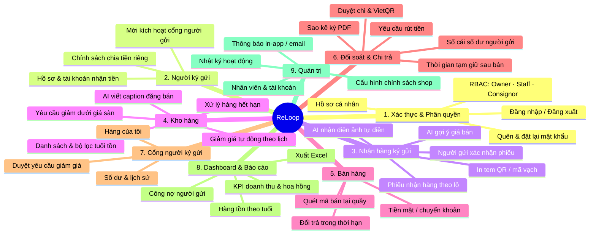

# ReLoop — Hệ thống Quản lý Shop Ký gửi Đồ 2hand

> Trạng thái thiết kế: **TARGET V1** · Giai đoạn: **Requirements (Bước 1–3)**
>
> Thời gian thực hiện: **5 tuần**

**ReLoop** giúp các shop ký gửi đồ secondhand nhỏ (quần áo si, đồ mẹ & bé, túi/giày hiệu cũ) quản lý toàn bộ vòng đời một món hàng ký gửi: **nhận hàng → định giá → niêm yết → giảm giá theo tuổi tồn → bán → đối soát → chi trả cho người ký gửi**. Hệ thống có cổng riêng để người ký gửi tự theo dõi hàng và số dư, và dùng AI để nhận diện món hàng từ ảnh và gợi ý giá bán.

---

## 1. Giới thiệu dự án

### 1.1 Bối cảnh

Mô hình ký gửi (consignment) đang phổ biến ở Việt Nam: người có đồ cũ mang đến shop, shop bán hộ và chia lại cho người gửi một tỷ lệ trên giá bán. Hầu hết shop nhỏ hiện quản lý bằng **Excel, sổ tay và tin nhắn Zalo/Messenger**. Mỗi món hàng thuộc một người gửi khác nhau, với tỷ lệ chia, thời hạn và mức giá sàn khác nhau. Vì vậy cuối tháng đối soát rất tốn công và dễ sai.

### 1.2 Vấn đề cần giải quyết

| # | Painpoint | Ai gặp | Hậu quả |
|---|---|---|---|
| P1 | Nhập thông tin từng món bằng tay khi nhận lô 30–50 món | Nhân viên | Mất 1–2 giờ/lô, sai sót mô tả |
| P2 | Định giá theo cảm tính | Chủ shop | Hàng tồn lâu hoặc bán hớ; người gửi thắc mắc |
| P3 | Không biết món nào tồn lâu, sắp hết hạn ký gửi | Chủ shop | Kho đầy hàng chết, quên trả lại hàng |
| P4 | Đối soát tiền cho từng người gửi bằng Excel | Chủ shop | Mất nhiều ngày/tháng, dễ sai, tranh chấp |
| P5 | Người gửi liên tục nhắn hỏi "đồ của em bán chưa?" | Chủ shop, người gửi | Mất thời gian, thiếu minh bạch |
| P6 | Giảm giá không có sự đồng ý của người gửi | Người gửi | Mất niềm tin, tranh chấp |

Phân tích chi tiết: [docs/01-research.md](docs/01-research.md).

### 1.3 Mục tiêu V1

- **Số hóa nhận hàng nhanh:** chụp ảnh, AI tự điền thông tin món hàng; nhân viên chỉ xác nhận.
- **Định giá có căn cứ:** AI gợi ý giá dựa trên lịch sử bán thực tế của chính shop.
- **Vòng đời hàng minh bạch:** trạng thái rõ ràng, giảm giá tự động theo quy tắc, không bao giờ xuống dưới giá sàn khi chưa có sự đồng ý của người gửi.
- **Đối soát & chi trả chính xác:** sổ cái số dư theo từng người gửi, tạo mã VietQR để chuyển khoản, xuất sao kê PDF.
- **Cổng người ký gửi:** tự xem hàng, số dư, duyệt yêu cầu giảm giá, yêu cầu rút tiền.

### 1.4 Ngoài phạm vi V1

Website bán hàng online, tích hợp cổng thanh toán, nhiều chi nhánh, hóa đơn điện tử/kế toán thuế, tích hợp vận chuyển, ứng dụng mobile native. Chi tiết: [docs/02-scope.md](docs/02-scope.md).

---

## 2. Product Mindmap

Bản Xmind gốc: [ReLoop — Product Mindmap trên Xmind](https://app.xmind.com/share/BYQqqcb4). Có 9 phân hệ và 2 quan hệ chéo: *Bán hàng → Tạm giữ tiền* và *Yêu cầu giảm dưới giá sàn → Người gửi duyệt*.


> Export ảnh từ Xmind (File → Export → PNG) rồi lưu thành `docs/mindmap/reloop-mindmap.png`. Sơ đồ Mermaid bên dưới là bản xem nhanh trên GitHub.



---

## 3. Vai trò & Phân quyền

| Vai trò | Mã | Mô tả |
|---|---|---|
| Chủ shop | `OWNER` | Toàn quyền: cấu hình chính sách, định giá, duyệt chi trả, báo cáo, quản lý nhân viên |
| Nhân viên | `STAFF` | Vận hành hằng ngày: nhận hàng, in tem, bán hàng, đổi trả trong hạn |
| Người ký gửi | `CONSIGNOR` | Dùng cổng riêng: xem hàng & số dư của mình, xác nhận phiếu, duyệt giảm giá, yêu cầu rút tiền |
| Hệ thống | `SYSTEM` | Tác nhân tự động (scheduler): giảm giá theo lịch, cảnh báo hết hạn, giải phóng tiền tạm giữ |

| Chức năng | OWNER | STAFF | CONSIGNOR |
|---|:---:|:---:|:---:|
| Dashboard | Toàn bộ | Ca bán của mình | Dashboard cá nhân |
| Quản lý người ký gửi | ✅ | Tạo mới, xem (ẩn thông tin ngân hàng) | — |
| Tạo phiếu nhận hàng + AI | ✅ | ✅ | — |
| Xác nhận phiếu nhận hàng | ✅ (tại quầy) | — | ✅ (phiếu của mình) |
| Sửa giá hàng đang bán | ✅ | — | — |
| Duyệt giảm dưới giá sàn | — | — | ✅ (hàng của mình) |
| Bán hàng | ✅ | ✅ | — |
| Đổi trả | ✅ | Trong thời hạn | — |
| Xem số dư người gửi | Tất cả | — | Của mình |
| Yêu cầu rút tiền | — | — | ✅ |
| Duyệt & chi trả | ✅ | — | — |
| Báo cáo, xuất Excel | ✅ | — | Sao kê của mình |
| Nhân viên, cấu hình, nhật ký | ✅ | — | — |

Quyền được kiểm tra ở **backend**; frontend chỉ ẩn nút và menu để cải thiện UX. Ma trận đầy đủ và use case: [docs/03-use-cases.md](docs/03-use-cases.md). User stories INVEST: [docs/04-user-stories.md](docs/04-user-stories.md).

---

## 4. Information Architecture

```text
ReLoop
├── Public
│   ├── Đăng nhập
│   ├── Quên mật khẩu / Đặt lại mật khẩu
│   └── Kích hoạt tài khoản (link mời)
├── Back-office (OWNER, STAFF) — sidebar + topbar
│   ├── Dashboard
│   ├── Nhận hàng (danh sách phiếu · tạo phiếu + AI · chi tiết phiếu)
│   ├── Kho hàng (danh sách · chi tiết món · in tem · yêu cầu giảm giá · hàng hết hạn)
│   ├── Bán hàng (POS · lịch sử đơn · đổi trả)
│   ├── Người ký gửi (danh sách · chi tiết: hàng / số dư / sao kê)
│   ├── Chi trả (yêu cầu rút tiền · lịch sử chi trả)
│   ├── Báo cáo
│   ├── Nhân viên · Cấu hình shop · Nhật ký hoạt động
│   └── Hồ sơ cá nhân
├── Consignor Portal (CONSIGNOR) — mobile-first, bottom nav
│   ├── Tổng quan · Hàng của tôi · Phiếu chờ xác nhận
│   ├── Yêu cầu giảm giá · Số dư & rút tiền · Sao kê
│   └── Hồ sơ
└── 403 / 404
```

Chi tiết screen hierarchy, danh sách màn hình, route và quyền truy cập: [docs/05-information-architecture.md](docs/05-information-architecture.md).

---

## 5. Tài liệu

| # | Yêu cầu | Tài liệu | Trạng thái |
|---|---|---|---|
| 1 | Phân tích đề bài top-down | [01-research.md](docs/01-research.md) · [02-scope.md](docs/02-scope.md) | ✅ Hoàn thành |
| 2 | Use case diagram, User stories INVEST | [03-use-cases.md](docs/03-use-cases.md) · [04-user-stories.md](docs/04-user-stories.md) | ✅ Hoàn thành |
| 3 | Information architecture | [05-information-architecture.md](docs/05-information-architecture.md) | ✅ Hoàn thành |
| 4 | UI/UX | — | ⏳ Chưa làm |
| 5 | DBML / ER (Mermaid) | — | ⏳ Chưa làm |
| 6 | OpenAPI | — | ⏳ Chưa làm |
| 7 | C4 Documentation | — | ⏳ Chưa làm |
| 8 | Code structure | — | ⏳ Chưa làm |
| 9 | Code | — | ⏳ Chưa làm |
