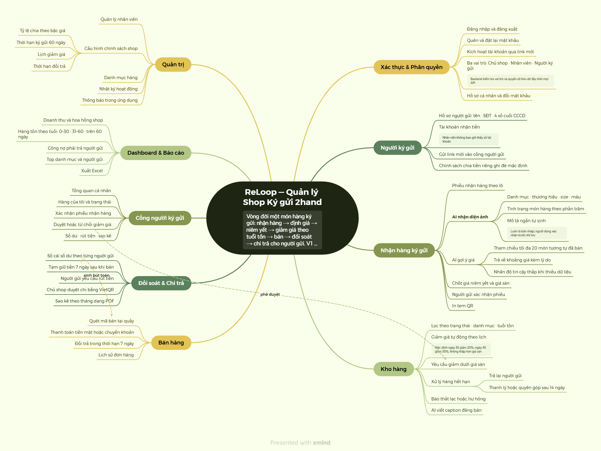

# ReLoop — Hệ thống Quản lý Shop Ký gửi Đồ 2hand

> Trạng thái thiết kế: **TARGET V1** · Giai đoạn: **Requirements (Bước 1–3)**
>
> Thời gian thực hiện: **5 tuần**

**ReLoop** giúp các shop ký gửi đồ secondhand nhỏ (quần áo si, đồ mẹ & bé, túi/giày hiệu cũ) quản lý toàn bộ vòng đời một món hàng ký gửi: **nhận hàng → định giá → niêm yết → giảm giá theo tuổi tồn → bán → đối soát → chi trả cho người ký gửi**. Hệ thống có cổng riêng để người ký gửi tự theo dõi hàng và số dư, và dùng AI để nhận diện món hàng từ ảnh và gợi ý giá bán.

---

## 1. Giới thiệu dự án

### 1.1 Bối cảnh

Mô hình ký gửi (consignment) đang phổ biến ở Việt Nam: người có đồ cũ mang đến shop, shop bán hộ và chia lại cho người gửi một tỷ lệ trên giá bán. Hầu hết shop nhỏ hiện quản lý bằng **Excel, sổ tay và tin nhắn Zalo/Messenger**. Mỗi món hàng thuộc một người gửi khác nhau, với tỷ lệ chia, thời hạn và mức giá sàn khác nhau. Vì vậy cuối tháng đối soát rất tốn công và dễ sai.

### 1.2 Vấn đề cần giải quyết

| # | Painpoint | Ai gặp | Hậu quả |
|---|---|---|---|
| P1 | Nhập thông tin từng món bằng tay khi nhận lô 30–50 món | Nhân viên | Mất 1–2 giờ/lô, sai sót mô tả |
| P2 | Định giá theo cảm tính | Chủ shop | Hàng tồn lâu hoặc bán hớ; người gửi thắc mắc |
| P3 | Không biết món nào tồn lâu, sắp hết hạn ký gửi | Chủ shop | Kho đầy hàng chết, quên trả lại hàng |
| P4 | Đối soát tiền cho từng người gửi bằng Excel | Chủ shop | Mất nhiều ngày/tháng, dễ sai, tranh chấp |
| P5 | Người gửi liên tục nhắn hỏi "đồ của em bán chưa?" | Chủ shop, người gửi | Mất thời gian, thiếu minh bạch |
| P6 | Giảm giá không có sự đồng ý của người gửi | Người gửi | Mất niềm tin, tranh chấp |

Phân tích chi tiết: [docs/01-research.md](docs/01-research.md).

### 1.3 Mục tiêu V1

- **Số hóa nhận hàng nhanh:** chụp ảnh, AI tự điền thông tin món hàng; nhân viên chỉ xác nhận.
- **Định giá có căn cứ:** AI gợi ý giá dựa trên lịch sử bán thực tế của chính shop.
- **Vòng đời hàng minh bạch:** trạng thái rõ ràng, giảm giá tự động theo quy tắc, không bao giờ xuống dưới giá sàn khi chưa có sự đồng ý của người gửi.
- **Đối soát & chi trả chính xác:** sổ cái số dư theo từng người gửi, tạo mã VietQR để chuyển khoản, xuất sao kê PDF.
- **Cổng người ký gửi:** tự xem hàng, số dư, duyệt yêu cầu giảm giá, yêu cầu rút tiền.

### 1.4 Ngoài phạm vi V1

Website bán hàng online, tích hợp cổng thanh toán, nhiều chi nhánh, hóa đơn điện tử/kế toán thuế, tích hợp vận chuyển, ứng dụng mobile native. Chi tiết: [docs/02-scope.md](docs/02-scope.md).

---

## 2. Product Mindmap

Bản Xmind gốc: [ReLoop — Product Mindmap trên Xmind](https://app.xmind.com/share/BYQqqcb4). Mindmap có 9 phân hệ và 2 quan hệ chéo: *Bán hàng → Tạm giữ tiền* và *Yêu cầu giảm dưới giá sàn → Người gửi duyệt*.



---

## 3. Vai trò & Phân quyền

| Vai trò | Mã | Mô tả |
|---|---|---|
| Chủ shop | `OWNER` | Toàn quyền: cấu hình chính sách, định giá, duyệt chi trả, báo cáo, quản lý nhân viên |
| Nhân viên | `STAFF` | Vận hành hằng ngày: nhận hàng, in tem, bán hàng, đổi trả trong hạn |
| Người ký gửi | `CONSIGNOR` | Dùng cổng riêng: xem hàng & số dư của mình, xác nhận phiếu, duyệt giảm giá, yêu cầu rút tiền |
| Hệ thống | `SYSTEM` | Tác nhân tự động (scheduler): giảm giá theo lịch, cảnh báo hết hạn, giải phóng tiền tạm giữ |

| Chức năng | OWNER | STAFF | CONSIGNOR |
|---|:---:|:---:|:---:|
| Dashboard | Toàn bộ | Ca bán của mình | Dashboard cá nhân |
| Quản lý người ký gửi | ✅ | Tạo mới, xem (ẩn thông tin ngân hàng) | — |
| Tạo phiếu nhận hàng + AI | ✅ | ✅ | — |
| Xác nhận phiếu nhận hàng | ✅ (tại quầy) | — | ✅ (phiếu của mình) |
| Sửa giá hàng đang bán | ✅ | — | — |
| Duyệt giảm dưới giá sàn | — | — | ✅ (hàng của mình) |
| Bán hàng | ✅ | ✅ | — |
| Đổi trả | ✅ | Trong thời hạn | — |
| Xem số dư người gửi | Tất cả | — | Của mình |
| Yêu cầu rút tiền | — | — | ✅ |
| Duyệt & chi trả | ✅ | — | — |
| Báo cáo, xuất Excel | ✅ | — | Sao kê của mình |
| Nhân viên, cấu hình, nhật ký | ✅ | — | — |

Quyền được kiểm tra ở **backend**; frontend chỉ ẩn nút và menu để cải thiện UX. Ma trận đầy đủ: [docs/03-use-cases.md](docs/03-use-cases.md).

---

## 4. Use Case tổng quát


| Tác nhân | Tính năng chính |
|---|---|
| **Chủ shop** | Quản lý người ký gửi · Nhận hàng · Quản lý kho & giá · Bán hàng · Đối soát & chi trả · Báo cáo & quản trị shop |
| **Nhân viên** | Quản lý người ký gửi · Nhận hàng · Quản lý kho · Bán hàng & đổi trả |
| **Người ký gửi** | Xác nhận phiếu & duyệt giảm giá · Theo dõi hàng, ví & rút tiền |
| **Scheduler** | Tự giảm giá theo lịch · Giải phóng tiền tạm giữ |
| **Claude API** | Nhận diện ảnh & gợi ý giá khi nhận hàng (`«extend»` Nhận hàng ký gửi: không bắt buộc, AI lỗi vẫn nhập tay được) |

Sơ đồ chi tiết theo từng vai trò (34 use case) và đặc tả luồng: [docs/03-use-cases.md](docs/03-use-cases.md).

---

## 5. User Stories — INVEST

### 5.1 Tiêu chí INVEST

Trước khi đưa vào sprint, mỗi user story đều được kiểm tra theo 6 tiêu chí INVEST:

| Tiêu chí | Ý nghĩa trong ReLoop |
|---|---|
| **I**ndependent | Mỗi story tạo ra một kết quả demo được; chỉ phụ thuộc story khác khi thật sự cần |
| **N**egotiable | Bố cục UI và cách cài đặt có thể đổi, miễn giữ nguyên mục tiêu, quy tắc nghiệp vụ và quyền |
| **V**aluable | Mỗi story nêu rõ lợi ích cho một vai trò và gắn với painpoint P1–P6 |
| **E**stimable | Đầu vào, đầu ra, vai trò, quy tắc nghiệp vụ (BRxx) và ngoại lệ đều được ghi rõ |
| **S**mall | Mỗi story là một năng lực, làm xong trong ≤ 3 ngày/người |
| **T**estable | Mỗi story có acceptance criteria quan sát được |

### 5.2 Product Backlog

Mỗi story tương ứng với use case cùng số (USxx ↔ UCxx). Ưu tiên theo MoSCoW; kế hoạch 5 tuần gồm tuần 1 làm tài liệu, Sprint 1–4 tương ứng tuần 2–5.

| ID | User story | Ưu tiên | Sprint |
|---|---|---|---|
| US01 | Là người dùng, tôi muốn **đăng nhập** để vào đúng khu vực theo vai trò | Must | S1 |
| US02 | Là người dùng, tôi muốn **đăng xuất** để kết thúc phiên trên thiết bị | Must | S1 |
| US03 | Là người dùng quên mật khẩu, tôi muốn **nhận link đặt lại qua email** | Could | S4 |
| US04 | Là nhân viên / người gửi được mời, tôi muốn **kích hoạt tài khoản bằng link mời** | Must | S2 |
| US05 | Là người dùng, tôi muốn **cập nhật hồ sơ và đổi mật khẩu** | Should | S4 |
| US06 | Là người dùng, tôi muốn **dashboard theo phạm vi vai trò** | Should | S4 |
| US07 | Là chủ shop / nhân viên, tôi muốn **tạo và tra cứu người ký gửi** | Must | S1 |
| US08 | Là chủ shop / nhân viên, tôi muốn **gửi link mời** để người gửi dùng cổng riêng | Must | S2 |
| US09 | Là chủ shop / nhân viên, tôi muốn **tạo phiếu nhận hàng theo lô** | Must | S1 |
| US10 | Là nhân viên, tôi muốn **AI nhận diện ảnh và tự điền** thông tin món hàng | Must | S3 |
| US11 | Là chủ shop, tôi muốn **AI gợi ý giá kèm lý do** dựa trên hàng đã bán | Must | S3 |
| US12 | Là người gửi, tôi muốn **xác nhận hoặc yêu cầu sửa phiếu** trước khi hàng lên kệ | Must | S2 |
| US13 | Là nhân viên, tôi muốn **in tem QR** cho món đã xác nhận | Should | S2 |
| US14 | Là chủ shop / nhân viên, tôi muốn **tìm và lọc kho** theo trạng thái, tuổi tồn | Must | S1 |
| US15 | Là chủ shop, tôi muốn **điều chỉnh giá** món đang bán (không dưới giá sàn) | Should | S2 |
| US16 | Là chủ shop, tôi muốn hệ thống **tự giảm giá theo lịch** | Must | S3 |
| US17 | Là chủ shop, tôi muốn **gửi yêu cầu giảm dưới giá sàn** cho người gửi | Should | S3 |
| US18 | Là người gửi, tôi muốn **đồng ý hoặc từ chối yêu cầu giảm giá** | Should | S3 |
| US19 | Là chủ shop / nhân viên, tôi muốn **xử lý hàng sắp/đã hết hạn** | Must | S3 |
| US20 | Là chủ shop, tôi muốn **báo thất lạc / hư hỏng** để ghi nhận bồi thường | Could | S4 |
| US21 | Là nhân viên, tôi muốn **AI viết caption đăng bán** | Could | S4 |
| US22 | Là nhân viên, tôi muốn **bán hàng bằng cách quét mã**, tự ghi phần chia | Must | S2 |
| US23 | Là nhân viên, tôi muốn **xử lý đổi trả** trong thời hạn | Should | S3 |
| US24 | Là người gửi, tôi muốn **xem số dư tạm giữ / khả dụng và lịch sử** | Must | S2 |
| US25 | Là người gửi, tôi muốn **yêu cầu rút tiền** | Must | S3 |
| US26 | Là chủ shop, tôi muốn **duyệt chi bằng mã VietQR** sinh sẵn | Must | S3 |
| US27 | Là chủ shop / người gửi, tôi muốn **xuất sao kê PDF theo tháng** | Should | S4 |
| US28 | Là chủ shop, tôi muốn **tiền tạm giữ tự chuyển sang khả dụng** sau thời hạn đổi trả | Must | S3 |
| US29 | Là người gửi, tôi muốn **xem hàng của mình** và số ngày còn lại | Must | S2 |
| US30 | Là chủ shop, tôi muốn **báo cáo doanh thu, hoa hồng, tồn kho, công nợ** và xuất Excel | Should | S4 |
| US31 | Là chủ shop, tôi muốn **quản lý tài khoản nhân viên** | Must | S1 |
| US32 | Là chủ shop, tôi muốn **cấu hình tỷ lệ chia, thời hạn, lịch giảm giá, danh mục** | Must | S1 |
| US33 | Là chủ shop, tôi muốn **xem nhật ký thao tác quan trọng** | Should | S4 |
| US34 | Là người dùng, tôi muốn **nhận thông báo in-app** khi có việc liên quan đến tôi | Should | S3 |

**Tổng:** 20 Must · 11 Should · 3 Could. Nếu thiếu thời gian, cắt nhóm Could (US03, US20, US21) trước.

### 5.3 Kết quả đánh giá INVEST

Cả **34/34 story đạt đủ 6 tiêu chí**. Ví dụ cách một số story đạt tiêu chí *Estimable* và *Testable*:

| Story | Điều làm story ước lượng & kiểm thử được |
|---|---|
| US10 AI nhận diện ảnh | Schema JSON cố định; timeout 15 giây; AI lỗi thì nhập tay; lưu đề xuất gốc của AI để đối chiếu |
| US16 Giảm giá tự động | Giá mới = max(giá niêm yết × (1 − % giảm), giá sàn), làm tròn 1.000đ; job chạy lại trong ngày không giảm hai lần |
| US22 Bán hàng POS | Khóa lạc quan chống bán trùng; có ca kiểm thử 2 món của 2 người gửi với tỷ lệ chia khác nhau |
| US26 Duyệt & chi trả | VietQR chứa đúng STK, số tiền, nội dung `RELOOP <mã>`; từ chối thì hoàn lại số dư |

Bảng đánh giá từng story và acceptance criteria (Gherkin) đầy đủ: [docs/04-user-stories.md](docs/04-user-stories.md).

---

## 6. Information Architecture

```text
ReLoop
├── Public
│   ├── Đăng nhập
│   ├── Quên mật khẩu / Đặt lại mật khẩu
│   └── Kích hoạt tài khoản (link mời)
├── Back-office (OWNER, STAFF) — sidebar + topbar
│   ├── Dashboard
│   ├── Nhận hàng (danh sách phiếu · tạo phiếu + AI · chi tiết phiếu)
│   ├── Kho hàng (danh sách · chi tiết món · in tem · yêu cầu giảm giá · hàng hết hạn)
│   ├── Bán hàng (POS · lịch sử đơn · đổi trả)
│   ├── Người ký gửi (danh sách · chi tiết: hàng / số dư / sao kê)
│   ├── Chi trả (yêu cầu rút tiền · lịch sử chi trả)
│   ├── Báo cáo
│   ├── Nhân viên · Cấu hình shop · Nhật ký hoạt động
│   └── Hồ sơ cá nhân
├── Consignor Portal (CONSIGNOR) — mobile-first, bottom nav
│   ├── Tổng quan · Hàng của tôi · Phiếu chờ xác nhận
│   ├── Yêu cầu giảm giá · Số dư & rút tiền · Sao kê
│   └── Hồ sơ
└── 403 / 404
```

Chi tiết screen hierarchy, danh sách màn hình, route và quyền truy cập: [docs/05-information-architecture.md](docs/05-information-architecture.md).

---

## 7. Tài liệu

| # | Yêu cầu | Tài liệu | Trạng thái |
|---|---|---|---|
| 1 | Phân tích đề bài top-down | [01-research.md](docs/01-research.md) · [02-scope.md](docs/02-scope.md) | ✅ Hoàn thành |
| 2 | Use case diagram, User stories INVEST | [03-use-cases.md](docs/03-use-cases.md) · [04-user-stories.md](docs/04-user-stories.md) | ✅ Hoàn thành |
| 3 | Information architecture | [05-information-architecture.md](docs/05-information-architecture.md) | ✅ Hoàn thành |
| 4 | UI/UX | — | ⏳ Chưa làm |
| 5 | DBML / ER (Mermaid) | — | ⏳ Chưa làm |
| 6 | OpenAPI | — | ⏳ Chưa làm |
| 7 | C4 Documentation | — | ⏳ Chưa làm |
| 8 | Code structure | — | ⏳ Chưa làm |
| 9 | Code | — | ⏳ Chưa làm |
