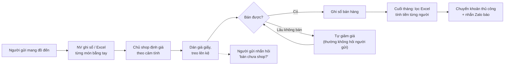
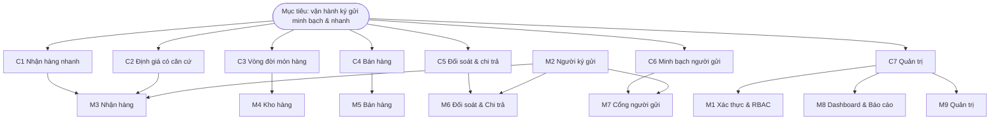
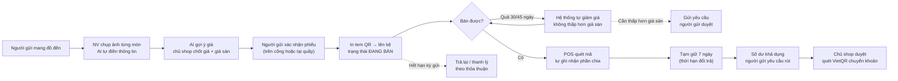

# 01 — Phân tích đề bài Top-down (Research)

> Trạng thái thiết kế: **TARGET V1**
>
> Phương pháp: đi từ **bối cảnh → mục tiêu → năng lực → phân hệ → tính năng**, mỗi tầng gắn với painpoint cụ thể để mọi tính năng đều có lý do tồn tại.

---

## 1. Bối cảnh thị trường

- Mua bán đồ secondhand ở Việt Nam, đặc biệt là quần áo "si", đồ mẹ & bé và túi/giày hiệu cũ, ngày càng phổ biến trong giới trẻ, nhờ xu hướng thời trang bền vững và tiết kiệm chi phí.
- Hình thức kinh doanh chính gồm:
  1. **Shop tự nhập hàng** (mua kiện, mua đứt). Mô hình này không thuộc phạm vi dự án.
  2. **Shop ký gửi (consignment):** người có đồ cũ gửi bán, shop bán hộ và hưởng hoa hồng. **Đây là đối tượng của ReLoop.**
  3. **Chợ online C2C** (nhóm Facebook, Chợ Tốt…): cá nhân tự bán, không qua shop.
- Shop ký gửi có lợi thế là **không cần vốn nhập hàng**. Đổi lại, shop phải gánh **độ phức tạp vận hành**: mỗi món là một "hợp đồng nhỏ" với một người gửi.

> ⚠️ Các nhận định thị trường trên là định tính. Nhóm cần kiểm chứng bằng khảo sát (mục 7) trước khi dùng làm số liệu trong báo cáo.

---

## 2. Các bên liên quan (Stakeholders)

| Bên liên quan | Mục tiêu | Mối quan tâm chính |
|---|---|---|
| **Chủ shop** | Bán nhanh, tối đa hoa hồng, giữ uy tín | Tốc độ nhận hàng, định giá đúng, đối soát chính xác, kho không ứ đọng |
| **Nhân viên** | Làm việc nhanh, ít sai | Nhập liệu ít, thao tác bán đơn giản |
| **Người ký gửi** | Bán được giá, nhận tiền đúng hạn | Minh bạch: hàng đã bán chưa, bán giá bao nhiêu, bao giờ nhận tiền |
| **Khách mua** | Mua đồ tốt, giá hợp lý | Không tương tác trực tiếp với hệ thống ở V1 |

---

## 3. Quy trình hiện tại (As-is) và painpoint

| Bước | Painpoint | Mức độ |
|---|---|---|
| Nhận hàng | Ghi tay 30–50 món/lô: mô tả, size, tình trạng | 🔴 Cao |
| Định giá | Cảm tính, không có dữ liệu tham chiếu; người gửi hay thắc mắc | 🟠 Trung bình |
| Lưu kho | Không biết món nào tồn bao lâu; quên hạn trả hàng | 🔴 Cao |
| Giảm giá | Không có quy tắc thống nhất, dễ gây tranh chấp | 🟠 Trung bình |
| Bán hàng | Tra sổ tìm món thuộc người gửi nào | 🟠 Trung bình |
| Đối soát | Lọc Excel, cộng tay, đối chiếu với đơn trả hàng | 🔴 Cao |
| Chi trả | Chuyển khoản từng người, gõ tay STK, dễ nhầm | 🟠 Trung bình |
| Giao tiếp | Trả lời tin nhắn hỏi tình trạng hàng | 🔴 Cao |

---

## 4. Phân tích đối thủ / giải pháp thay thế

| Giải pháp | Điểm mạnh | Điểm yếu với shop ký gửi VN |
|---|---|---|
| **Excel / Google Sheets + sổ tay** | Miễn phí, quen thuộc | Không tự tính hoa hồng theo người gửi, không có cổng cho người gửi, dễ sai công thức |
| **Phần mềm POS bán lẻ phổ biến ở VN** | Bán hàng, tồn kho tốt | Thiết kế cho hàng tự nhập (SKU số lượng nhiều); không có khái niệm "chủ sở hữu món hàng", tỷ lệ chia, giá sàn, chi trả người gửi *(cần kiểm chứng từng sản phẩm)* |
| **Phần mềm ký gửi chuyên biệt nước ngoài** (ví dụ ConsignCloud, SimpleConsign) | Đúng nghiệp vụ ký gửi, có cổng người gửi | Tiếng Anh, giá theo USD/tháng, không hỗ trợ VietQR, không hợp quy mô shop nhỏ VN |
| **ReLoop** | Đúng nghiệp vụ ký gửi, tiếng Việt, VietQR, AI nhận diện & gợi ý giá | Chưa có website bán hàng, mới hỗ trợ một chi nhánh (V1) |

**Khoảng trống thị trường:** chưa có giải pháp nào vừa đúng nghiệp vụ ký gửi, vừa bản địa hóa cho shop nhỏ ở VN.

---

## 5. Phân rã Top-down

### 5.1 Tầng 1 — Mục tiêu sản phẩm

> **"Giúp shop ký gửi nhỏ vận hành minh bạch và nhanh hơn, từ lúc nhận món hàng đến lúc trả tiền cho người gửi."**

### 5.2 Tầng 2 — Năng lực cốt lõi (Capabilities)

| Mã | Năng lực | Giải quyết painpoint |
|---|---|---|
| C1 | Số hóa nhận hàng nhanh | P1 |
| C2 | Định giá có căn cứ | P2 |
| C3 | Quản lý vòng đời món hàng | P3, P6 |
| C4 | Bán hàng gắn với chủ sở hữu | P4 |
| C5 | Đối soát & chi trả chính xác | P4 |
| C6 | Minh bạch với người gửi | P5, P6 |
| C7 | Quản trị & kiểm soát | Tất cả (an toàn, truy vết) |

### 5.3 Tầng 3 — Phân hệ (Modules)

### 5.4 Tầng 4 — Tính năng (Features)

| Phân hệ | Tính năng chính | Ưu tiên |
|---|---|---|
| M1 Xác thực & RBAC | Đăng nhập, đăng xuất, quên mật khẩu, kích hoạt qua link mời, hồ sơ | Must |
| M2 Người ký gửi | CRUD hồ sơ, tài khoản nhận tiền, mời vào cổng, chính sách chia riêng | Must |
| M3 Nhận hàng | Phiếu nhận theo lô, **AI nhận diện ảnh**, **AI gợi ý giá**, giá sàn, người gửi xác nhận, in tem | Must |
| M4 Kho hàng | Danh sách & lọc, giảm giá tự động, yêu cầu giảm dưới giá sàn, hết hạn, thất lạc, AI caption | Must (caption: Could) |
| M5 Bán hàng | POS quét mã, thanh toán, đổi trả | Must |
| M6 Đối soát & Chi trả | Sổ cái, tạm giữ, yêu cầu rút, duyệt chi + VietQR, sao kê PDF | Must (PDF: Should) |
| M7 Cổng người gửi | Tổng quan, hàng của tôi, xác nhận phiếu, duyệt giảm giá, rút tiền | Must |
| M8 Dashboard & Báo cáo | KPI, tuổi tồn, công nợ, xuất Excel | Should |
| M9 Quản trị | Nhân viên, cấu hình chính sách, danh mục, nhật ký, thông báo | Must (thông báo email: Could) |

---

## 6. Quy trình mục tiêu (To-be)

---

## 7. Giả định cần kiểm chứng & kế hoạch khảo sát

| # | Giả định | Cách kiểm chứng | Tiêu chí xác nhận |
|---|---|---|---|
| A1 | Shop ký gửi nhỏ hiện quản lý bằng Excel/sổ tay | Phỏng vấn 5–10 shop (Facebook/Instagram) | ≥ 60% shop dùng Excel/sổ tay |
| A2 | Đối soát cuối tháng tốn nhiều thời gian | Hỏi số giờ/tháng dành cho đối soát | Trung bình ≥ 4 giờ/tháng |
| A3 | Người gửi thường xuyên hỏi tình trạng hàng | Hỏi số tin nhắn/tuần | ≥ 10 tin/tuần |
| A4 | AI nhận diện ảnh đủ chính xác để tiết kiệm thời gian | Thử 30 ảnh sản phẩm thật | ≥ 80% trường đúng, không cần sửa |
| A5 | Người gửi sẵn sàng dùng cổng web | Hỏi 5–10 người từng ký gửi | ≥ 60% sẵn sàng |

**Câu hỏi phỏng vấn chủ shop (gợi ý):**
1. Shop đang ghi nhận hàng ký gửi bằng cách nào?
2. Một lần nhận hàng có bao nhiêu món, mất bao lâu?
3. Shop chia tiền cho người gửi theo tỷ lệ nào? Có thay đổi theo giá trị món hàng không?
4. Sau bao lâu thì hàng không bán được bị trả lại? Có giảm giá dần không?
5. Cuối tháng đối soát và trả tiền mất bao lâu? Đã từng nhầm chưa?
6. Đã từng có tranh chấp với người gửi chưa? Về vấn đề gì?

---

## 8. Chỉ số thành công (Success metrics)

| Chỉ số | Hiện trạng (giả định) | Mục tiêu V1 |
|---|---|---|
| Thời gian nhập một món hàng | ~2 phút | ≤ 30 giây (có AI) |
| Thời gian đối soát cuối tháng | Vài giờ đến vài ngày | ≤ 15 phút (xuất sao kê tự động) |
| Tỷ lệ trường AI điền đúng | — | ≥ 80% |
| Số tin nhắn hỏi tình trạng hàng | Nhiều | Giảm ≥ 50% nhờ cổng người gửi |
| Sai lệch tiền chi trả | Có xảy ra | 0 (tính bằng quy tắc, có audit) |

---

**Liên quan:** [Phạm vi V1](02-scope.md) · [Use cases](03-use-cases.md) · [User stories](04-user-stories.md)
