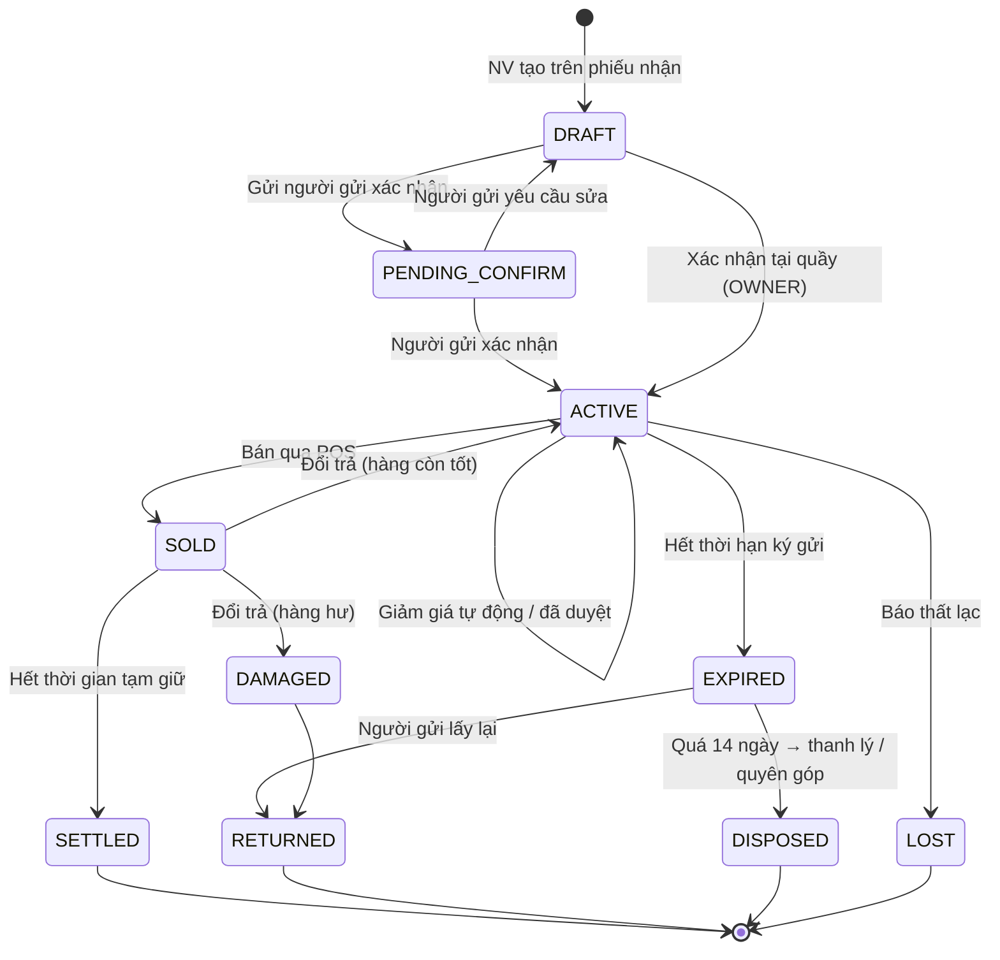

# 02 — Phạm vi V1 & Quy tắc nghiệp vụ

> Trạng thái thiết kế: **TARGET V1**

Tên sản phẩm trên giao diện: **ReLoop**.

## 1. Phạm vi V1

ReLoop V1 phục vụ **một shop ký gửi, một điểm bán**, gồm:

- Đăng nhập, phân quyền 3 vai trò (`OWNER`, `STAFF`, `CONSIGNOR`), kích hoạt tài khoản qua link mời.
- Quản lý người ký gửi và tài khoản nhận tiền của họ.
- Phiếu nhận hàng theo lô, có **AI nhận diện ảnh** và **AI gợi ý giá**.
- Quản lý kho hàng, giảm giá tự động theo tuổi tồn, xử lý hàng hết hạn.
- Bán hàng tại quầy (POS quét mã), đổi trả.
- Sổ cái số dư người gửi, yêu cầu rút tiền, duyệt chi kèm mã VietQR, sao kê.
- Cổng người ký gửi (mobile-first).
- Dashboard, báo cáo, xuất Excel, nhật ký hoạt động, thông báo in-app.

## 2. Ngoài phạm vi (Non-goals)

| Không làm ở V1 | Lý do |
|---|---|
| Website / app bán hàng online cho khách mua | Ngoài nghiệp vụ cốt lõi, quá rộng cho 5 tuần |
| Tích hợp cổng thanh toán (VNPay, MoMo…) | Chỉ sinh **mã VietQR tĩnh** để chuyển khoản; xác nhận đã chuyển bằng tay |
| Nhiều chi nhánh / nhiều shop (multi-tenant) | V1 chỉ một shop |
| Hóa đơn điện tử, kế toán thuế | Không thuộc phạm vi đồ án |
| Tích hợp vận chuyển | Bán tại quầy là chính |
| Ứng dụng mobile native | Cổng người gửi là web responsive |
| Tự train / fine-tune mô hình AI | Dùng API mô hình đa phương thức có sẵn |
| Gửi thông báo qua Zalo / SMS | Chỉ in-app (và email nếu kịp) |

## 3. Quy tắc nghiệp vụ (Business Rules)

Các giá trị mặc định do `OWNER` cấu hình trong **Cấu hình shop**. Nếu một người gửi có chính sách riêng thì chính sách riêng ghi đè giá trị mặc định.

| Mã | Quy tắc | Mặc định |
|---|---|---|
| BR01 | **Tỷ lệ chia** cho người gửi theo bậc giá bán: < 200.000đ → 50%; 200.000–1.000.000đ → 60%; > 1.000.000đ → 70% | Cấu hình được |
| BR02 | **Thời hạn ký gửi** tính từ ngày món hàng chuyển sang `ĐANG BÁN` | 60 ngày |
| BR03 | **Lịch giảm giá tự động:** ngày 30 giảm 20%, ngày 45 giảm 35% so với giá niêm yết ban đầu. Giá sau giảm **không bao giờ thấp hơn giá sàn** | Cấu hình được |
| BR04 | Muốn bán **dưới giá sàn** phải có yêu cầu và người gửi đồng ý. Yêu cầu tự hết hạn sau 3 ngày không phản hồi | 3 ngày |
| BR05 | **Thời gian tạm giữ:** phần tiền của người gửi chỉ chuyển sang *khả dụng* sau khi hết thời hạn đổi trả | 7 ngày |
| BR06 | **Rút tiền tối thiểu** | 100.000đ |
| BR07 | **Hết hạn ký gửi:** thông báo trước 7 ngày. Sau khi hết hạn, người gửi có 14 ngày để lấy lại hàng. Quá hạn, món hàng được xử lý theo lựa chọn ghi trên phiếu (*trả lại* / *shop thanh lý* / *quyên góp*) | 7 / 14 ngày |
| BR08 | Đổi trả chỉ chấp nhận trong thời hạn tạm giữ. Nếu đổi trả, phần chia của người gửi bị hủy và món hàng quay lại `ĐANG BÁN` (hoặc `HƯ HỎNG`) | — |
| BR09 | Kết quả AI (thông tin món, giá gợi ý) **luôn chỉ là bản nháp**, phải có người xác nhận trước khi lưu. Hệ thống ghi lại AI đã đề xuất gì và người dùng đã sửa gì | — |
| BR10 | Tiền lưu dạng **số nguyên VND**, làm tròn đến 1.000đ khi giảm giá. Mọi thao tác liên quan đến tiền đều ghi nhật ký (audit) | — |
| BR11 | Tiền chi trả **chỉ được tính bằng quy tắc** (BR01, BR05, BR08), không dùng AI | — |
| BR12 | Món hàng `THẤT LẠC` do lỗi shop: shop bồi thường cho người gửi bằng **giá sàn** × tỷ lệ chia | — |

## 4. Vòng đời món hàng



| Trạng thái | Tên hiển thị | Ý nghĩa |
|---|---|---|
| `DRAFT` | Nháp | Đang nhập trên phiếu nhận |
| `PENDING_CONFIRM` | Chờ người gửi xác nhận | Đã gửi lên cổng người gửi |
| `ACTIVE` | Đang bán | Đã lên kệ, tính tuổi tồn |
| `SOLD` | Đã bán (tạm giữ) | Trong thời hạn đổi trả |
| `SETTLED` | Đã quyết toán | Phần chia đã vào số dư khả dụng |
| `EXPIRED` | Hết hạn | Chờ người gửi lấy lại |
| `RETURNED` | Đã trả lại | Người gửi đã nhận lại hàng |
| `DISPOSED` | Đã thanh lý | Thanh lý / quyên góp theo thỏa thuận |
| `DAMAGED` | Hư hỏng | Không bán tiếp |
| `LOST` | Thất lạc | Áp dụng BR12 |

## 5. Ví dụ tính tiền

> Món áo khoác niêm yết 500.000đ, giá sàn 300.000đ. Sau 30 ngày chưa bán, hệ thống giảm 20% → **400.000đ**. Khách mua ở giá 400.000đ.
>
> - Bậc giá 200.000–1.000.000đ → người gửi nhận **60%** = **240.000đ** (trạng thái *tạm giữ*).
> - Shop giữ 160.000đ hoa hồng.
> - Sau 7 ngày không đổi trả → 240.000đ chuyển sang **số dư khả dụng** của người gửi.

## 6. Kiến trúc dự kiến (sẽ chi tiết ở bước C4)

```text
React (Back-office + Consignor Portal)
    → REST / HTTPS / JSON
Backend API (3 lớp) + Scheduler (giảm giá, hết hạn, giải phóng tạm giữ)
    → PostgreSQL
    → Object storage (ảnh sản phẩm)
    → Claude API (Haiku: nhận diện ảnh · Sonnet: gợi ý giá)
```

---

**Liên quan:** [Research](01-research.md) · [Use cases](03-use-cases.md)
