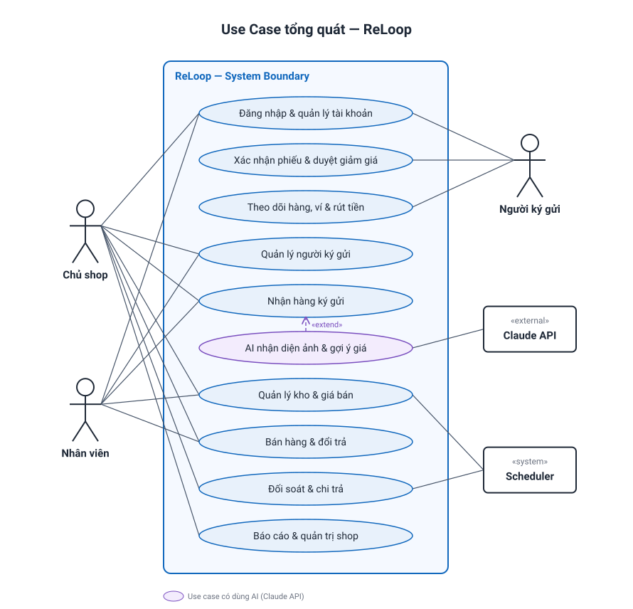
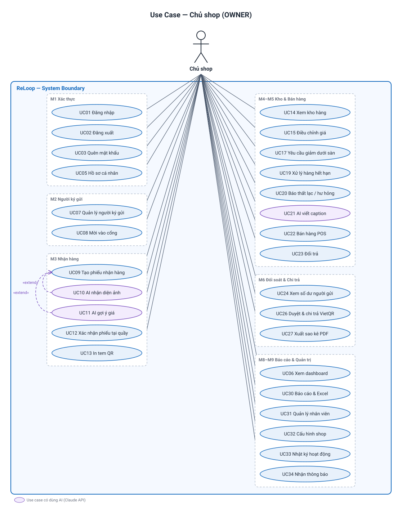
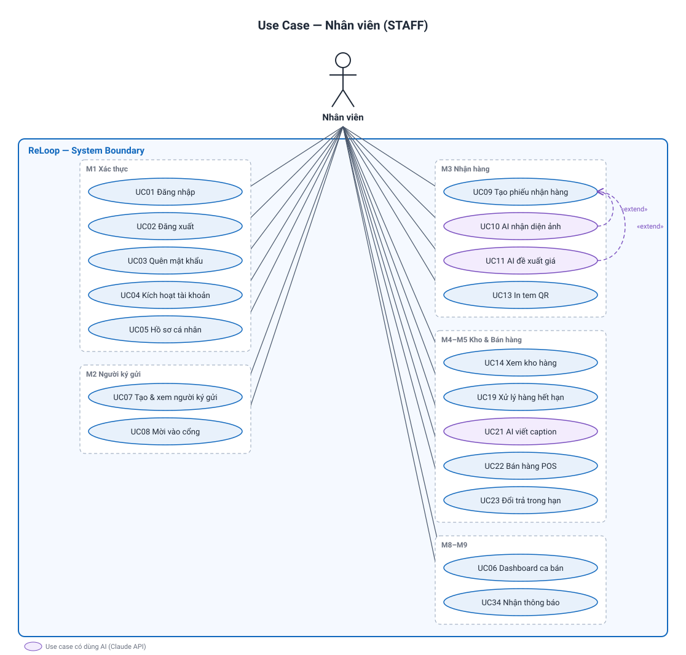
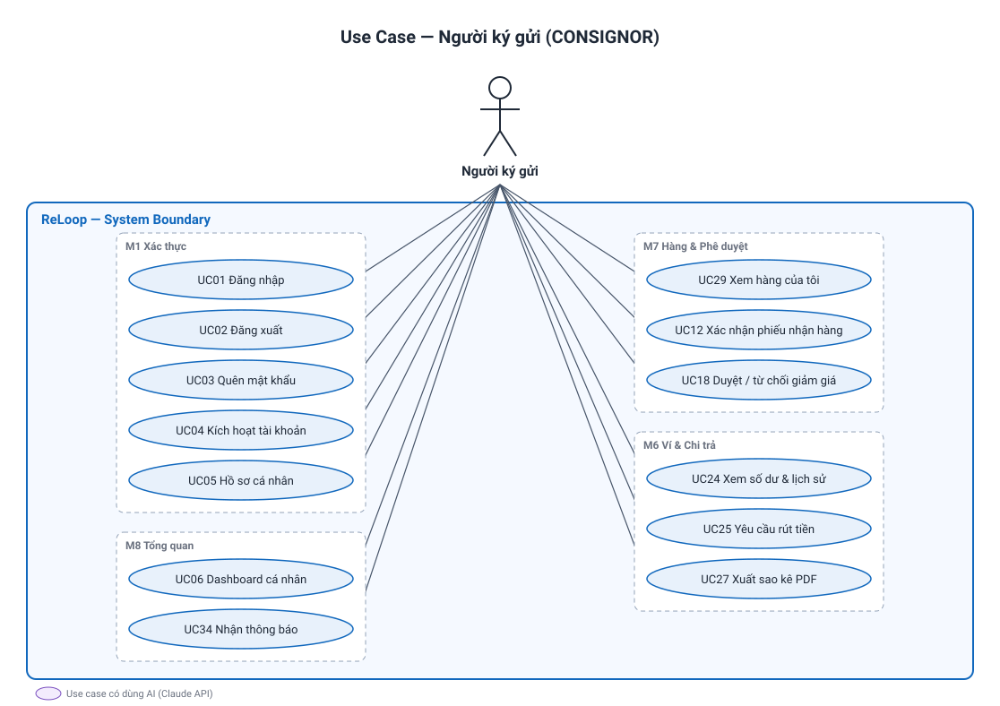
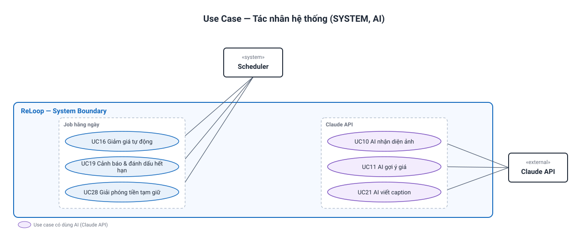

# 03 — Tác nhân, Vai trò, Phân quyền & Use Case

> Trạng thái thiết kế: **TARGET V1**

## 1. Tác nhân (Actors)

| Mã vai trò | Tên hiển thị | Loại | Giao diện sử dụng |
|---|---|---|---|
| `OWNER` | Chủ shop | Người dùng | Back-office |
| `STAFF` | Nhân viên | Người dùng | Back-office |
| `CONSIGNOR` | Người ký gửi | Người dùng | Consignor Portal |
| `SYSTEM` | Hệ thống (Scheduler) | Tác nhân tự động | Không có giao diện, chạy định kỳ hằng ngày |
| `AI` | Dịch vụ AI (Claude API) | Hệ thống ngoài | Được gọi khi nhận hàng và tạo caption |

Mỗi tài khoản có đúng **một** vai trò. Tài khoản `CONSIGNOR` luôn gắn với đúng một hồ sơ người ký gửi.

## 2. Ma trận phân quyền (Role × Feature)

| Chức năng | OWNER | STAFF | CONSIGNOR |
|---|:---:|:---:|:---:|
| Đăng nhập, đăng xuất, quên mật khẩu, hồ sơ cá nhân | ✓ | ✓ | ✓ |
| Dashboard | Toàn shop | Ca bán của mình | Cá nhân |
| Xem danh sách người ký gửi | ✓ | ✓ (ẩn STK ngân hàng) | |
| Tạo người ký gửi, gửi link mời | ✓ | ✓ | |
| Sửa / vô hiệu hóa người ký gửi, chính sách chia riêng | ✓ | | |
| Tạo / sửa phiếu nhận hàng (khi còn `DRAFT`) | ✓ | ✓ | |
| Dùng AI nhận diện ảnh, AI gợi ý giá | ✓ | ✓ | |
| Chốt giá niêm yết & giá sàn | ✓ | Đề xuất | |
| Xác nhận phiếu nhận hàng | ✓ (tại quầy) | | ✓ (phiếu của mình) |
| In tem QR | ✓ | ✓ | |
| Xem kho hàng | ✓ | ✓ | Chỉ hàng của mình |
| Sửa giá món đang bán | ✓ | | |
| Tạo yêu cầu giảm dưới giá sàn | ✓ | | |
| Duyệt / từ chối yêu cầu giảm giá | | | ✓ (hàng của mình) |
| Xử lý hàng hết hạn (trả lại / thanh lý) | ✓ | ✓ | |
| Báo thất lạc / hư hỏng | ✓ | | |
| AI tạo caption đăng bán | ✓ | ✓ | |
| Bán hàng (POS) | ✓ | ✓ | |
| Đổi trả | ✓ | Trong thời hạn | |
| Xem số dư, lịch sử giao dịch | Tất cả người gửi | | Của mình |
| Yêu cầu rút tiền | | | ✓ |
| Duyệt & chi trả | ✓ | | |
| Xuất sao kê PDF | ✓ | | Của mình |
| Báo cáo, xuất Excel | ✓ | | |
| Quản lý nhân viên | ✓ | | |
| Cấu hình chính sách shop, danh mục | ✓ | | |
| Nhật ký hoạt động | ✓ | | |
| Nhận thông báo | ✓ | ✓ | ✓ |

**Quy tắc thực thi:**
- Backend kiểm tra **vai trò** và **quyền sở hữu dữ liệu** trên mọi API. Ví dụ, `CONSIGNOR` chỉ truy cập được dữ liệu có `consignor_id` của chính mình.
- Menu và nút không có quyền sẽ **không được hiển thị**. Truy cập URL trái phép → trang `403`.
- `STAFF` không bao giờ nhận được số tài khoản ngân hàng của người gửi trong response API (che phía server).

## 3. Danh sách Use Case

| ID | Use case | Tác nhân | Phân hệ |
|---|---|---|---|
| UC01 | Đăng nhập | Tất cả | M1 |
| UC02 | Đăng xuất | Tất cả | M1 |
| UC03 | Quên & đặt lại mật khẩu | Tất cả | M1 |
| UC04 | Kích hoạt tài khoản qua link mời | STAFF, CONSIGNOR | M1 |
| UC05 | Quản lý hồ sơ cá nhân | Tất cả | M1 |
| UC06 | Xem dashboard | Tất cả (phạm vi khác nhau) | M8 |
| UC07 | Quản lý người ký gửi | OWNER, STAFF (giới hạn) | M2 |
| UC08 | Mời người ký gửi vào cổng | OWNER, STAFF | M2 |
| UC09 | Tạo phiếu nhận hàng | OWNER, STAFF | M3 |
| UC10 | AI nhận diện ảnh tự điền thông tin | OWNER, STAFF, AI | M3 |
| UC11 | AI gợi ý giá bán | OWNER, STAFF, AI | M3 |
| UC12 | Xác nhận phiếu nhận hàng | CONSIGNOR, OWNER | M3 |
| UC13 | In tem QR | OWNER, STAFF | M3 |
| UC14 | Xem & tìm kiếm kho hàng | OWNER, STAFF | M4 |
| UC15 | Điều chỉnh giá món hàng | OWNER | M4 |
| UC16 | Giảm giá tự động theo lịch | SYSTEM | M4 |
| UC17 | Tạo yêu cầu giảm dưới giá sàn | OWNER | M4 |
| UC18 | Duyệt / từ chối yêu cầu giảm giá | CONSIGNOR | M7 |
| UC19 | Xử lý hàng hết hạn | OWNER, STAFF, SYSTEM | M4 |
| UC20 | Báo thất lạc / hư hỏng | OWNER | M4 |
| UC21 | AI tạo caption đăng bán | OWNER, STAFF, AI | M4 |
| UC22 | Bán hàng tại quầy (POS) | OWNER, STAFF | M5 |
| UC23 | Đổi trả | OWNER, STAFF | M5 |
| UC24 | Xem số dư & lịch sử giao dịch | OWNER, CONSIGNOR | M6 |
| UC25 | Yêu cầu rút tiền | CONSIGNOR | M6 |
| UC26 | Duyệt & chi trả (VietQR) | OWNER | M6 |
| UC27 | Xuất sao kê kỳ (PDF) | OWNER, CONSIGNOR | M6 |
| UC28 | Giải phóng tiền tạm giữ | SYSTEM | M6 |
| UC29 | Xem hàng của tôi | CONSIGNOR | M7 |
| UC30 | Xem báo cáo & xuất Excel | OWNER | M8 |
| UC31 | Quản lý nhân viên | OWNER | M9 |
| UC32 | Cấu hình chính sách shop & danh mục | OWNER | M9 |
| UC33 | Xem nhật ký hoạt động | OWNER | M9 |
| UC34 | Nhận thông báo | Tất cả | M9 |

## 4. Use Case Diagram

Các sơ đồ được vẽ theo chuẩn UML và sinh từ [usecase/build_usecase_diagrams.py](usecase/build_usecase_diagrams.py). Sửa danh sách use case trong script rồi chạy `python docs/usecase/build_usecase_diagrams.py` để vẽ lại.

### 4.1 Tổng quát (tính năng chính)

### 4.2 Chi tiết theo vai trò

Mỗi tác nhân có một sơ đồ riêng; use case được nhóm theo phân hệ, elip màu tím là use case có dùng AI.

**Quan hệ giữa các use case:**
- **UC10, UC11 `«extend»` UC09:** khi tạo phiếu, người dùng có thể (không bắt buộc) dùng AI. Nếu AI lỗi, vẫn nhập tay được.
- **UC17 `«include»` UC18:** mọi yêu cầu giảm dưới giá sàn đều phải đi qua bước người gửi duyệt.
- **UC22 → UC28:** mỗi giao dịch bán sinh ra một khoản tạm giữ, sau này SYSTEM giải phóng.

## 5. Đặc tả các use case trọng tâm

### UC09 (+UC10, UC11) — Tạo phiếu nhận hàng có AI

| Mục | Nội dung |
|---|---|
| Tác nhân | OWNER, STAFF; AI (Claude API) |
| Tiền điều kiện | Người dùng đã đăng nhập; người ký gửi đã tồn tại và đang hoạt động |
| Hậu điều kiện | Phiếu nhận ở trạng thái `DRAFT` hoặc `PENDING_CONFIRM`; mỗi món hàng có ảnh, thông tin, giá niêm yết, giá sàn |

**Luồng chính**
1. NV chọn người ký gửi và tạo phiếu nhận mới. Hệ thống áp dụng chính sách chia (riêng hoặc mặc định) và lựa chọn xử lý khi hết hạn.
2. NV thêm món hàng bằng cách chụp hoặc tải lên 1–4 ảnh.
3. *(UC10)* NV bấm **"AI nhận diện"**. Hệ thống gửi ảnh đến AI, nhận về JSON gồm danh mục, thương hiệu, size, màu, tình trạng và mô tả, rồi điền vào form. Các trường do AI điền được đánh dấu riêng.
4. NV kiểm tra và sửa các trường nếu cần.
5. *(UC11)* NV bấm **"Gợi ý giá"**. Hệ thống lấy tối đa 20 món tương tự **đã bán** của shop, gửi kèm thông tin món hàng đến AI, và nhận về khoảng giá, giá đề xuất và lý do.
6. OWNER chốt giá niêm yết và giá sàn. STAFF chỉ đề xuất giá, OWNER duyệt sau.
7. Lặp lại bước 2–6 cho các món khác, sau đó bấm **"Gửi người gửi xác nhận"** → phiếu chuyển sang `PENDING_CONFIRM` và người gửi nhận thông báo.

**Luồng thay thế / ngoại lệ**
- 3a. AI lỗi hoặc quá 15 giây → thông báo "Không nhận diện được, vui lòng nhập tay". Form vẫn dùng được bình thường.
- 3b. Ảnh không phải sản phẩm → AI trả `confidence` thấp → hệ thống cảnh báo, không tự điền.
- 5a. Shop chưa có lịch sử bán món tương tự → AI chỉ gợi ý theo kiến thức chung, kèm nhãn "độ tin cậy thấp".
- 7a. Người gửi đang có mặt tại quầy → OWNER bấm **"Xác nhận tại quầy"** → món hàng chuyển thẳng sang `ACTIVE` (UC12).

### UC22 — Bán hàng tại quầy (POS)

| Mục | Nội dung |
|---|---|
| Tác nhân | OWNER, STAFF |
| Tiền điều kiện | Các món hàng ở trạng thái `ACTIVE` |
| Hậu điều kiện | Đơn hàng được tạo; các món chuyển sang `SOLD`; mỗi món sinh một bút toán **tạm giữ** cho người gửi theo BR01 |

**Luồng chính:** quét QR hoặc mã vạch (hoặc tìm theo mã) → món vào giỏ với giá hiện tại → chọn phương thức thanh toán (tiền mặt / chuyển khoản, có hiển thị VietQR của shop) → xác nhận → in hoặc hiển thị hóa đơn.

**Ngoại lệ:** món không ở `ACTIVE` → từ chối và hiển thị trạng thái hiện tại; hai thiết bị cùng bán một món → giao dịch đến sau thất bại (khóa lạc quan).

### UC17 + UC18 — Giảm dưới giá sàn

1. OWNER chọn món `ACTIVE`, nhập giá mới thấp hơn giá sàn kèm lý do → hệ thống tạo yêu cầu `PENDING` và thông báo cho người gửi.
2. Người gửi mở cổng và **Đồng ý** (giá bán và giá sàn mới được áp dụng) hoặc **Từ chối** (có thể kèm lựa chọn "Tôi sẽ đến lấy lại").
3. Sau 3 ngày không phản hồi → yêu cầu `EXPIRED`, giá giữ nguyên (BR04).

### UC26 — Duyệt & chi trả

1. OWNER mở danh sách yêu cầu rút tiền `PENDING`.
2. Hệ thống hiển thị số dư khả dụng, thông tin ngân hàng và **mã VietQR** sinh sẵn (số tiền, nội dung `RELOOP <mã yêu cầu>`).
3. OWNER quét mã bằng app ngân hàng để chuyển khoản, sau đó bấm **"Đã chuyển"** (có thể đính kèm ảnh biên lai).
4. Hệ thống ghi bút toán trừ số dư, chuyển yêu cầu sang `PAID`, thông báo cho người gửi và ghi audit.

**Ngoại lệ:** OWNER **Từ chối** kèm lý do → yêu cầu `REJECTED`, số dư được hoàn lại cho người gửi.

---

**Liên quan:** [User stories INVEST](04-user-stories.md) · [Phạm vi & quy tắc](02-scope.md) · [Information architecture](05-information-architecture.md)
