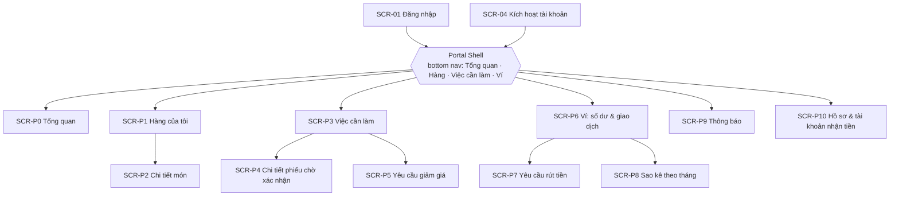
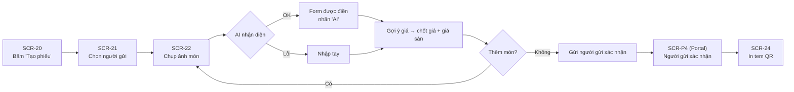
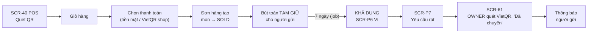
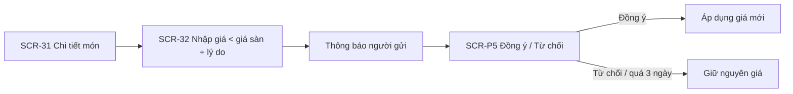

# 05 — Information Architecture & Screen Hierarchy

> Trạng thái thiết kế: **TARGET V1**

ReLoop có **hai giao diện (shell)** cho hai nhóm người dùng khác nhau, dùng chung một backend:

| Shell | Người dùng | Bố cục | Thiết bị chính |
|---|---|---|---|
| **Back-office** | OWNER, STAFF | Sidebar trái + topbar (thông báo, hồ sơ) | Laptop / máy tính quầy; POS dùng được trên tablet |
| **Consignor Portal** | CONSIGNOR | Header + bottom navigation 4 tab | Điện thoại (mobile-first) |

Sau khi đăng nhập, hệ thống điều hướng theo vai trò: `OWNER`/`STAFF` → `/app/dashboard`, `CONSIGNOR` → `/portal`. Vào nhầm shell → `403`.

## 1. Cây Information Architecture

```text
ReLoop
│
├── Public (không cần đăng nhập)
│   ├── Đăng nhập
│   ├── Quên mật khẩu
│   ├── Đặt lại mật khẩu (link email)
│   └── Kích hoạt tài khoản (link mời)
│
├── Back-office (OWNER, STAFF)
│   ├── Dashboard
│   ├── Nhận hàng
│   │   ├── Danh sách phiếu nhận (lọc theo trạng thái, người gửi, ngày)
│   │   ├── Tạo / sửa phiếu nhận
│   │   │   └── Form món hàng (ảnh · AI nhận diện · AI gợi ý giá)
│   │   ├── Chi tiết phiếu nhận
│   │   └── In tem QR
│   ├── Kho hàng
│   │   ├── Tất cả hàng (lọc trạng thái, danh mục, người gửi, tuổi tồn)
│   │   ├── Sắp / đã hết hạn
│   │   ├── Yêu cầu giảm giá
│   │   └── Chi tiết món (thông tin · lịch sử giá · lịch sử trạng thái · AI caption)
│   ├── Bán hàng
│   │   ├── POS (quét mã · giỏ hàng · thanh toán)
│   │   ├── Lịch sử đơn
│   │   └── Chi tiết đơn → Đổi trả
│   ├── Người ký gửi
│   │   ├── Danh sách
│   │   ├── Thêm / sửa người gửi
│   │   └── Chi tiết người gửi (hồ sơ · hàng · phiếu nhận · sổ cái số dư · sao kê)
│   ├── Chi trả                                  [OWNER]
│   │   ├── Yêu cầu rút tiền → Duyệt chi (VietQR)
│   │   └── Lịch sử chi trả
│   ├── Báo cáo                                  [OWNER]
│   ├── Quản trị                                 [OWNER]
│   │   ├── Nhân viên
│   │   ├── Cấu hình shop (thông tin & VietQR · chính sách chia · thời hạn & giảm giá · danh mục)
│   │   └── Nhật ký hoạt động
│   ├── Thông báo (panel trên topbar)
│   └── Hồ sơ cá nhân (tài khoản · bảo mật)
│
├── Consignor Portal (CONSIGNOR)
│   ├── Tổng quan (số dư · việc cần làm · hàng mới bán)
│   ├── Hàng của tôi → Chi tiết món
│   ├── Việc cần làm
│   │   ├── Phiếu chờ xác nhận → Chi tiết phiếu (xác nhận / yêu cầu sửa)
│   │   └── Yêu cầu giảm giá (đồng ý / từ chối)
│   ├── Ví
│   │   ├── Số dư & lịch sử giao dịch
│   │   ├── Yêu cầu rút tiền
│   │   └── Sao kê theo tháng (PDF)
│   ├── Thông báo
│   └── Hồ sơ (thông tin · tài khoản nhận tiền · đổi mật khẩu)
│
└── Hệ thống: 403 Không có quyền · 404 Không tìm thấy
```

## 2. Screen Hierarchy

### 2.1 Back-office

```mermaid
flowchart TB
    login["SCR-01 Đăng nhập"] --> shell{{"Back-office Shell<br/>sidebar + topbar"}}
    shell --> dash["SCR-10 Dashboard"]

    shell --> intakeList["SCR-20 Danh sách phiếu nhận"]
    intakeList --> intakeForm["SCR-21 Tạo / sửa phiếu nhận"]
    intakeForm --> itemForm["SCR-22 Drawer: Form món hàng<br/>+ AI nhận diện + AI gợi ý giá"]
    intakeList --> intakeDetail["SCR-23 Chi tiết phiếu nhận"]
    intakeDetail --> labels["SCR-24 In tem QR"]

    shell --> items["SCR-30 Kho hàng<br/>tab: Tất cả · Sắp/đã hết hạn · Yêu cầu giảm giá"]
    items --> itemDetail["SCR-31 Chi tiết món"]
    itemDetail --> priceModal["SCR-32 Modal: Đổi giá /<br/>Yêu cầu giảm dưới sàn"]
    itemDetail --> captionModal["SCR-33 Modal: AI caption"]
    itemDetail --> lostModal["SCR-34 Modal: Báo thất lạc / hư hỏng"]

    shell --> pos["SCR-40 POS"]
    shell --> orders["SCR-41 Lịch sử đơn"]
    orders --> orderDetail["SCR-42 Chi tiết đơn"]
    orderDetail --> returnModal["SCR-43 Modal: Đổi trả"]

    shell --> consignors["SCR-50 Danh sách người gửi"]
    consignors --> consignorForm["SCR-51 Modal: Thêm / sửa người gửi"]
    consignors --> consignorDetail["SCR-52 Chi tiết người gửi<br/>tab: Hồ sơ · Hàng · Phiếu · Sổ cái · Sao kê"]
    consignorDetail --> inviteModal["SCR-53 Modal: Link mời"]

    shell --> payouts["SCR-60 Yêu cầu rút tiền"]
    payouts --> payoutModal["SCR-61 Modal: Duyệt chi + VietQR"]
    shell --> payoutHistory["SCR-62 Lịch sử chi trả"]

    shell --> reports["SCR-70 Báo cáo"]
    shell --> staff["SCR-80 Nhân viên"]
    shell --> settings["SCR-81 Cấu hình shop<br/>tab: Thông tin · Chia tiền · Thời hạn & giảm giá · Danh mục"]
    shell --> audit["SCR-82 Nhật ký hoạt động"]
    shell --> notif["SCR-85 Panel thông báo"]
    shell --> profile["SCR-88 Hồ sơ cá nhân"]

    classDef owner fill:#fdecea,stroke:#c0392b
    class payouts,payoutModal,payoutHistory,reports,staff,settings,audit owner
```



> Các ô màu đỏ là màn hình **chỉ OWNER** truy cập được. Các ô còn lại dùng chung cho OWNER và STAFF, nhưng hành động trên màn hình được giới hạn theo quyền.

### 2.2 Consignor Portal



## 3. Danh sách màn hình (Screen Inventory)

| Screen ID | Màn hình | Kiểu hiển thị | Vai trò | Stories |
|---|---|---|---|---|
| `SCR-01` | Đăng nhập | Page | Public | US01 |
| `SCR-02` | Quên mật khẩu | Page | Public | US03 |
| `SCR-03` | Đặt lại mật khẩu | Page | Public | US03 |
| `SCR-04` | Kích hoạt tài khoản | Page | Public (có token) | US04 |
| `SCR-10` | Dashboard | Page | OWNER, STAFF | US06 |
| `SCR-20` | Danh sách phiếu nhận | Page | OWNER, STAFF | US09 |
| `SCR-21` | Tạo / sửa phiếu nhận | Page | OWNER, STAFF | US09, US12 (xác nhận tại quầy) |
| `SCR-22` | Form món hàng + AI | Drawer trên SCR-21 | OWNER, STAFF | US09, US10, US11 |
| `SCR-23` | Chi tiết phiếu nhận | Page | OWNER, STAFF | US09, US12 |
| `SCR-24` | In tem QR | Print view | OWNER, STAFF | US13 |
| `SCR-30` | Kho hàng (3 tab) | Page | OWNER, STAFF | US14, US17, US19 |
| `SCR-31` | Chi tiết món | Page | OWNER, STAFF | US14, US15, US16 |
| `SCR-32` | Đổi giá / yêu cầu giảm dưới sàn | Modal | OWNER | US15, US17 |
| `SCR-33` | AI caption | Modal | OWNER, STAFF | US21 |
| `SCR-34` | Báo thất lạc / hư hỏng | Modal | OWNER | US20 |
| `SCR-40` | POS | Page (toàn màn hình) | OWNER, STAFF | US22 |
| `SCR-41` | Lịch sử đơn | Page | OWNER, STAFF | US22 |
| `SCR-42` | Chi tiết đơn | Page | OWNER, STAFF | US22, US23 |
| `SCR-43` | Đổi trả | Modal | OWNER, STAFF (trong hạn) | US23 |
| `SCR-50` | Danh sách người gửi | Page | OWNER, STAFF | US07 |
| `SCR-51` | Thêm / sửa người gửi | Modal | OWNER (sửa), STAFF (thêm) | US07 |
| `SCR-52` | Chi tiết người gửi (5 tab) | Page | OWNER; STAFF chỉ tab Hồ sơ, Hàng, Phiếu | US07, US24, US27 |
| `SCR-53` | Link mời | Modal | OWNER, STAFF | US08 |
| `SCR-60` | Yêu cầu rút tiền | Page | OWNER | US26 |
| `SCR-61` | Duyệt chi + VietQR | Modal | OWNER | US26 |
| `SCR-62` | Lịch sử chi trả | Page | OWNER | US26 |
| `SCR-70` | Báo cáo | Page | OWNER | US30 |
| `SCR-80` | Nhân viên | Page + modal | OWNER | US31 |
| `SCR-81` | Cấu hình shop (4 tab) | Page | OWNER | US32 |
| `SCR-82` | Nhật ký hoạt động | Page | OWNER | US33 |
| `SCR-85` | Thông báo | Panel (dropdown) | OWNER, STAFF | US34 |
| `SCR-88` | Hồ sơ cá nhân | Page (2 tab) | OWNER, STAFF | US05 |
| `SCR-P0` | Tổng quan | Page | CONSIGNOR | US06 |
| `SCR-P1` | Hàng của tôi | Page | CONSIGNOR | US29 |
| `SCR-P2` | Chi tiết món | Page | CONSIGNOR | US29 |
| `SCR-P3` | Việc cần làm | Page | CONSIGNOR | US12, US18 |
| `SCR-P4` | Chi tiết phiếu chờ xác nhận | Page | CONSIGNOR | US12 |
| `SCR-P5` | Yêu cầu giảm giá | Page / bottom sheet | CONSIGNOR | US18 |
| `SCR-P6` | Ví | Page | CONSIGNOR | US24 |
| `SCR-P7` | Yêu cầu rút tiền | Page | CONSIGNOR | US25 |
| `SCR-P8` | Sao kê | Page | CONSIGNOR | US27 |
| `SCR-P9` | Thông báo | Page | CONSIGNOR | US34 |
| `SCR-P10` | Hồ sơ & tài khoản nhận tiền | Page | CONSIGNOR | US05 |
| `SCR-90` | 403 Không có quyền | Page | Tất cả | Phân quyền chung |
| `SCR-91` | 404 Không tìm thấy | Page | Tất cả | — |

**Tổng: 45 màn hình** (4 trang public, 18 trang Back-office, 11 trang Portal, 9 modal/drawer/panel, 1 print view, 2 trang lỗi).

## 4. Routes

| Route | Screen | Ghi chú |
|---|---|---|
| `/login` | SCR-01 | |
| `/forgot-password` | SCR-02 | |
| `/reset-password?token=` | SCR-03 | |
| `/activate?token=` | SCR-04 | |
| `/app/dashboard` | SCR-10 | |
| `/app/intakes` | SCR-20 | |
| `/app/intakes/new` · `/app/intakes/:id/edit` | SCR-21 | Chỉ sửa được khi phiếu `DRAFT` |
| `/app/intakes/:id` | SCR-23 | |
| `/app/intakes/:id/labels` | SCR-24 | |
| `/app/items?tab=all\|expiring\|price-requests` | SCR-30 | |
| `/app/items/:id` | SCR-31 | |
| `/app/pos` | SCR-40 | |
| `/app/orders` · `/app/orders/:id` | SCR-41 · SCR-42 | |
| `/app/consignors` · `/app/consignors/:id?tab=` | SCR-50 · SCR-52 | |
| `/app/payouts` · `/app/payouts/history` | SCR-60 · SCR-62 | OWNER |
| `/app/reports` | SCR-70 | OWNER |
| `/app/staff` | SCR-80 | OWNER |
| `/app/settings?tab=` | SCR-81 | OWNER |
| `/app/audit` | SCR-82 | OWNER |
| `/app/profile` | SCR-88 | |
| `/portal` | SCR-P0 | |
| `/portal/items` · `/portal/items/:id` | SCR-P1 · SCR-P2 | |
| `/portal/todo` · `/portal/intakes/:id` · `/portal/price-requests/:id` | SCR-P3 · SCR-P4 · SCR-P5 | |
| `/portal/wallet` · `/portal/wallet/withdraw` · `/portal/wallet/statements` | SCR-P6 · SCR-P7 · SCR-P8 | |
| `/portal/notifications` · `/portal/profile` | SCR-P9 · SCR-P10 | |
| `/403` · `*` | SCR-90 · SCR-91 | |

Modal và drawer mở trên trang cha bằng state cục bộ; không cần route riêng ở V1.

## 5. Điều hướng (Navigation)

### 5.1 Sidebar Back-office

| Nhóm | Mục menu | OWNER | STAFF |
|---|---|:---:|:---:|
| — | Dashboard | ✓ | ✓ |
| Vận hành | Nhận hàng | ✓ | ✓ |
| | Kho hàng | ✓ | ✓ |
| | Bán hàng (POS, Lịch sử đơn) | ✓ | ✓ |
| | Người ký gửi | ✓ | ✓ |
| Tài chính | Chi trả | ✓ | |
| | Báo cáo | ✓ | |
| Quản trị | Nhân viên | ✓ | |
| | Cấu hình shop | ✓ | |
| | Nhật ký hoạt động | ✓ | |

Topbar: nút **Bán hàng nhanh** (mở POS), chuông thông báo kèm badge, menu hồ sơ (Hồ sơ cá nhân, Đăng xuất). Mục không có quyền **không được render**.

### 5.2 Bottom navigation Portal

`Tổng quan` · `Hàng của tôi` · `Việc cần làm` (badge số việc chờ) · `Ví`. Thông báo và hồ sơ nằm ở header.

## 6. Các luồng người dùng chính (User Flows)

### 6.1 Nhận hàng có AI (STAFF → CONSIGNOR)



### 6.2 Bán hàng → Tiền về ví người gửi



### 6.3 Giảm giá dưới giá sàn



## 7. Trạng thái màn hình (Screen States)

Mọi màn hình danh sách và form đều định nghĩa đủ các trạng thái sau:

| Trạng thái | Hiển thị |
|---|---|
| Loading | Skeleton theo bố cục bảng/thẻ; không dùng spinner toàn trang |
| Empty | Minh họa + câu hướng dẫn + nút hành động chính (ví dụ: "Chưa có phiếu nhận nào — Tạo phiếu đầu tiên") |
| Empty do bộ lọc | "Không có kết quả phù hợp" + nút **Xóa bộ lọc** |
| Validation error | Lỗi hiển thị ngay dưới trường; tóm tắt lỗi ở đầu form nếu có ≥ 2 lỗi |
| Saving | Nút chính bị khóa, hiển thị "Đang lưu…"; chống bấm lặp |
| Success | Toast 3 giây; hành động tiền bạc dùng hộp xác nhận trước khi thực hiện |
| AI đang xử lý | Shimmer trên các trường sẽ được điền + nút **Hủy**; form vẫn sửa được |
| AI lỗi | Banner vàng "Không nhận diện được, vui lòng nhập tay"; không chặn thao tác |
| Lỗi hệ thống / mạng | Banner đỏ + nút **Thử lại**; dữ liệu form đang nhập được giữ lại |
| Không có quyền | Chuyển đến `SCR-90` |

## 8. Quyền truy cập trang

| Trang | OWNER | STAFF | CONSIGNOR |
|---|:---:|:---:|:---:|
| SCR-01 → SCR-04 | Public | Public | Public |
| SCR-10, SCR-20 → SCR-24, SCR-30, SCR-31, SCR-40 → SCR-42, SCR-50, SCR-52, SCR-85, SCR-88 | ✓ | ✓ | |
| SCR-32, SCR-34 | ✓ | | |
| SCR-43 | ✓ | Trong hạn đổi trả | |
| SCR-60 → SCR-62, SCR-70, SCR-80 → SCR-82 | ✓ | | |
| SCR-P0 → SCR-P10 | | | ✓ |
| SCR-90, SCR-91 | ✓ | ✓ | ✓ |

## 9. Ánh xạ Requirement → Màn hình

| Story | Màn hình / hành động chính |
|---|---|
| US01 · US02 | `SCR-01` gửi đăng nhập · topbar/header → Đăng xuất |
| US03 | `SCR-02` → email → `SCR-03` |
| US04 | `SCR-04` đặt mật khẩu từ link mời |
| US05 | `SCR-88` / `SCR-P10` |
| US06 | `SCR-10` / `SCR-P0` |
| US07 · US08 | `SCR-50`, `SCR-51`, `SCR-52` · `SCR-53` |
| US09 · US10 · US11 | `SCR-21` + `SCR-22` (nút **AI nhận diện**, **Gợi ý giá**) |
| US12 | `SCR-P4` (xác nhận / yêu cầu sửa) · `SCR-21` (xác nhận tại quầy) |
| US13 | `SCR-23` → `SCR-24` |
| US14 · US15 · US16 | `SCR-30`, `SCR-31` (lịch sử giá) · `SCR-32` |
| US17 · US18 | `SCR-32` · `SCR-P5` |
| US19 · US20 · US21 | `SCR-30` tab *Sắp/đã hết hạn* · `SCR-34` · `SCR-33` |
| US22 · US23 | `SCR-40` · `SCR-42` → `SCR-43` |
| US24 | `SCR-52` tab *Sổ cái* · `SCR-P6` |
| US25 · US26 | `SCR-P7` · `SCR-60` → `SCR-61` |
| US27 | `SCR-52` tab *Sao kê* · `SCR-P8` |
| US28 | Không có màn hình (job); kết quả thấy ở `SCR-P6` |
| US29 | `SCR-P1`, `SCR-P2` |
| US30 · US31 · US32 · US33 | `SCR-70` · `SCR-80` · `SCR-81` · `SCR-82` |
| US34 | `SCR-85` / `SCR-P9` |

## 10. Nguyên tắc UX áp dụng cho bước UI/UX tiếp theo

- **Tốc độ ở quầy:** POS và nhận hàng tối ưu cho bàn phím và máy quét; nút chính luôn nằm cùng một vị trí.
- **AI minh bạch:** luôn phân biệt dữ liệu do AI điền và dữ liệu do người nhập; không bao giờ tự lưu.
- **Tiền bạc rõ ràng:** số tiền định dạng `1.250.000 ₫`; luôn tách *tạm giữ* và *khả dụng*; hành động tiền bạc cần xác nhận hai bước.
- **Portal cho điện thoại:** vùng chạm ≥ 44 px, thẻ thay cho bảng, hành động chính đặt ở cuối màn hình.
- **Khả năng truy cập:** độ tương phản WCAG AA; trạng thái không chỉ thể hiện bằng màu (có thêm nhãn chữ / icon).

---

**Liên quan:** [Use cases](03-use-cases.md) · [User stories](04-user-stories.md) · [Phạm vi & quy tắc](02-scope.md)
